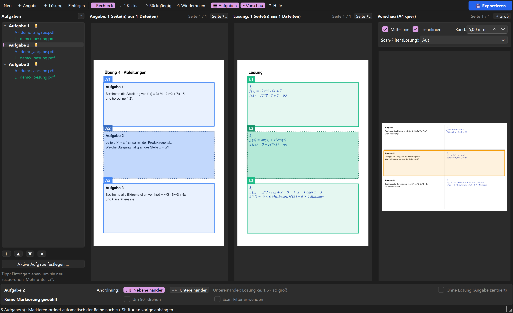

# 📐 Übung Merger

**Angabe links, Lösung rechts – als sauberes A4-Querformat-PDF, fertig zum Beamen.**

[](https://github.com/spheppner/uebung-merger/releases/latest)
[](LICENSE)


Du hast eine Angabe als PDF und die Lösung als PDF oder Handyfoto? Übung Merger schneidet die einzelnen Aufgaben aus, ordnet jede Angabe ihrer Lösung zu und setzt alles auf übersichtliche Seiten. Perfekt für Übungen, die live gezeigt werden.

<sub>*English: a small desktop tool that merges exercise sheets and their solutions side by side into projector-friendly landscape PDFs.*</sub>


## ⬇️ Download (Windows)

**[Neueste Version herunterladen](https://github.com/spheppner/uebung-merger/releases/latest)** – die `.exe` doppelklicken, fertig. Python wird nicht gebraucht.

> Windows warnt beim ersten Start eventuell („Der Computer wurde durch Windows geschützt“), weil die Datei nicht signiert ist. Mit **Weitere Informationen → Trotzdem ausführen** startet sie normal.

## ✨ Das kann es

- **Markieren statt Kopieren** – Aufgaben mit der Maus aufziehen, die n-te Angabe passt automatisch zur n-ten Lösung.
- **PDFs und Handyfotos** – per Drag & Drop oder Strg+V einfügen, auch mehrere Dateien.
- **Live-Vorschau** – du siehst sofort, wie das Ergebnis aussieht. Ein Klick darauf wählt die Aufgabe.
- **Flexible Anordnung** – nebeneinander oder untereinander, mit Größenvergleich. Aufgaben ohne Lösung stehen zentriert.
- **Scan-Filter** – macht aus Fotos auf Karopapier saubere Scans (Schatten und Karo verschwinden).



## 🚀 Aus dem Quelltext starten

Für macOS/Linux oder zum Mitentwickeln:

```
pip install -r requirements.txt
python -m uebung_merger
```

Dateien kannst du auch gleich mitgeben:

```
python -m uebung_merger [angabe.pdf] [loesung.pdf|bild.jpg ...]
```

> `numpy` und `opencv-python-headless` braucht nur der Scan-Filter. Ohne sie läuft alles andere.

## 🧭 So geht's

1. **Hinzufügen** – Angabe und Lösung in die jeweilige Spalte ziehen (oder Strg+V).
2. **Markieren** – Bereiche aufziehen. Mit **Shift** hängst du einen Bereich an die vorige Aufgabe an.
3. **Prüfen** – in der Vorschau, bei Bedarf in der Liste umordnen oder die Anordnung ändern.
4. **Exportieren** – **Strg+S**.

Hilfe gibt es im Programm unter **?** (F1), alle Details am Anfang von [`uebung_merger/app.py`](uebung_merger/app.py).

| Taste | Aktion |
|---|---|
| `R` / `P` | Rechteck ziehen / 4 Klicks |
| `Esc` | Auswahl abbrechen |
| `Entf` | Markierung löschen |
| `Strg+Z` / `Strg+Y` | Rückgängig / Wiederholen |
| `Strg+S` | Exportieren |

## 🗂 Struktur

```
uebung_merger/
├── app.py          Einstiegspunkt (main)
├── main_window.py  Hauptfenster
├── views.py        Seitenansichten, Markierwerkzeuge
├── task_tree.py    Aufgabenliste mit Drag & Drop
├── model.py        Markierungen, Aufgaben, Zuordnung (ohne Qt)
├── layout.py       Aufbau der Ausgabe-PDF
├── scan.py         Scan-Filter
├── documents.py    PDFs/Bilder laden, drehen
├── options.py      Layout- und Filter-Einstellungen
├── constants.py    Konstanten
└── assets/         App-Icon
scripts/
├── build_exe.py        Windows-EXE bauen (PyInstaller)
├── make_demo_gif.py    docs/demo.gif neu aufnehmen
└── make_icon.py        App-Icon erzeugen
```

## 📦 Version und Release

Die Version steht an genau einer Stelle: `uebung_merger/__version__`. Sie erscheint im Fenstertitel, bei `python -m uebung_merger --version`, in den EXE-Eigenschaften und im Paket.

EXE bauen (am besten in einer frischen venv):

```
pip install -r requirements.txt pyinstaller pillow
python scripts/build_exe.py      # -> release/UebungMerger-<Version>-windows.exe
```

Wird ein Tag `vX.Y.Z` gepusht, baut GitHub Actions die EXE (als Artefakt) und hängt sie an das Release, falls dort noch keine liegt.

## 📄 Lizenz

[GNU AGPL-3.0](LICENSE). Übung Merger nutzt [PyMuPDF](https://pymupdf.readthedocs.io/) (AGPL-3.0) und [Qt für Python](https://doc.qt.io/qtforpython-6/) (LGPL-3.0); die AGPL ist deshalb die passende Lizenz für das Gesamtprogramm.
